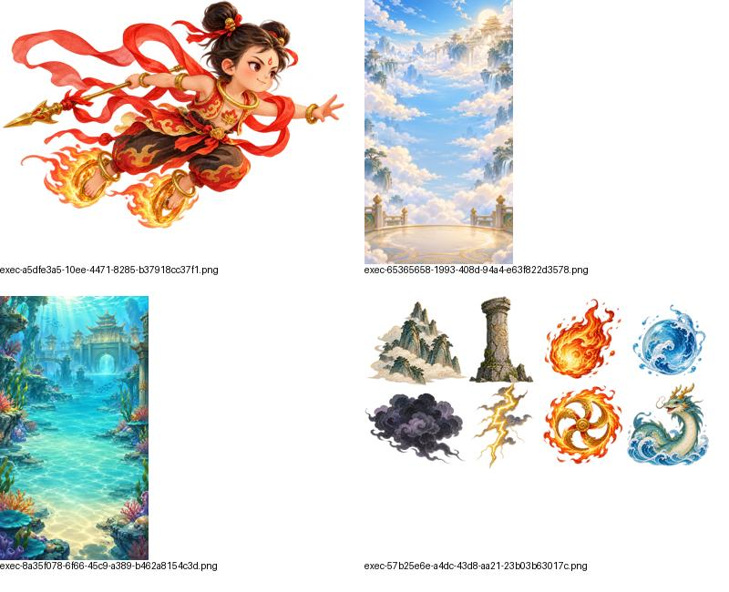
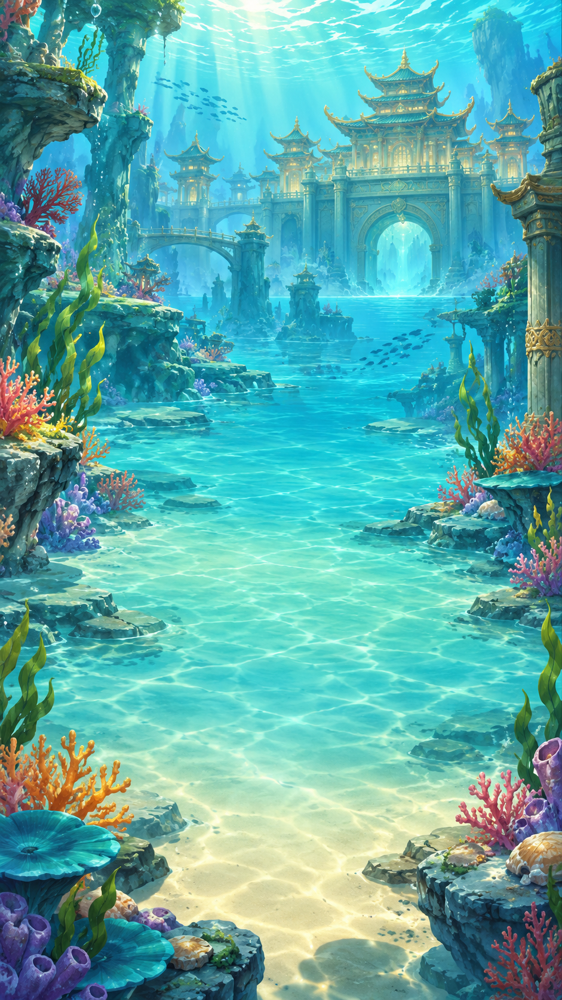

# 哪吒今天不闹海

一款以东方神话为主题的竖屏轻游戏。点击屏幕让哪吒腾空，穿越天宫和海底龙宫的障碍，挑战更高分数。

## 玩法

- 点击开始后，再点击玩法区域起飞；每次点击提供一次向上动力，不点击时角色会自然下落。
- 穿过一组障碍获得 1 分，碰撞障碍或屏幕边界结束本局。难度随分数提高。
- 天宫与龙宫轮换出现，每局场景固定；支持暂停和重新开始。

## 美术素材

项目采用明亮、温暖的东方绘本风格，包含哪吒动作、天宫与龙宫背景，以及多种障碍。

| 哪吒概念 | 天宫 | 龙宫 |
| --- | --- | --- |
|  |  |  |

更多原图、动作预览和生产素材见 [game_assets](game_assets/README.md)；运行素材位于正式工程的 `assets/resources/art`。

## 项目结构

- `nezha-sky-adventure-fresh/`：正式 Cocos Creator 工程，当前版本 0.6.3。
- `nezha-sky-adventure/`：早期工程快照。
- `game_assets/`：概念图、动画预览与生产素材。
- `docs/`：设计、实现和测试记录。

## 运行与开发

使用 Cocos Creator **3.8.8** 打开 `nezha-sky-adventure-fresh`，打开 `assets/scenes/game.scene` 并预览。工程使用 TypeScript，竖屏设计分辨率为 750 × 1334。构建 Web 或微信小游戏及验证脚本的详细说明见 [工程 README](nezha-sky-adventure-fresh/README.md)。

目前已接入角色、双场景、障碍及碰撞；音频、最高分存档和完整首页流程仍待实现。微信开发者工具加载、真机运行及性能仍需验收，微信构建配置使用游客 AppID。

## 文档

- [游戏设计文档](docs/GDD.md)
- [正式素材接入](docs/正式素材接入.md)
- [障碍系统](docs/障碍系统.md)
- [测试记录与问题清单](docs/测试记录与问题清单.md)
